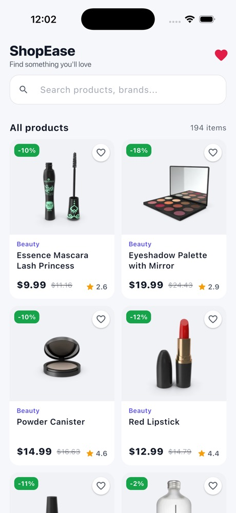
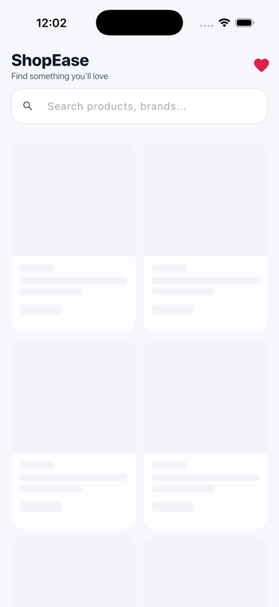
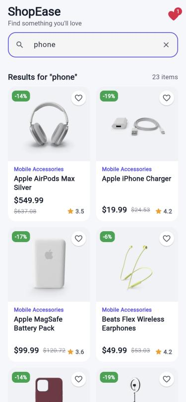
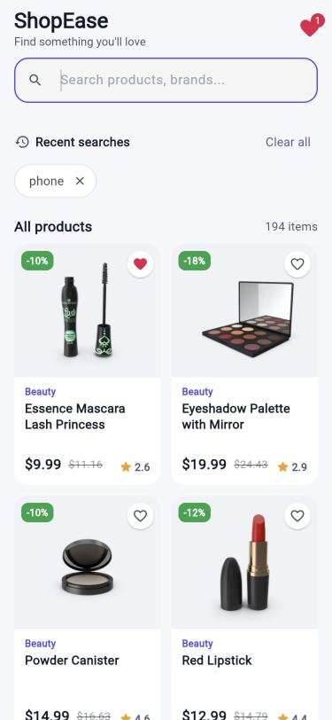
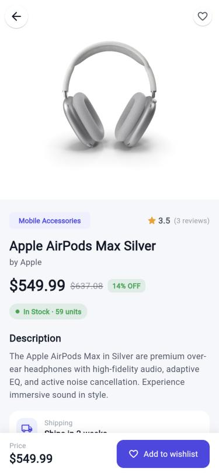
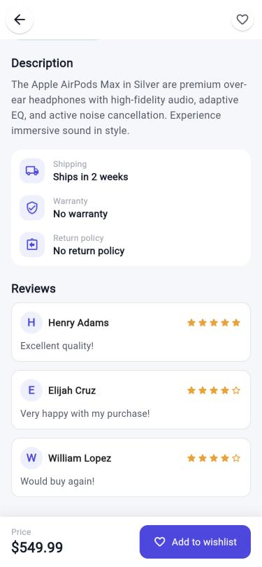
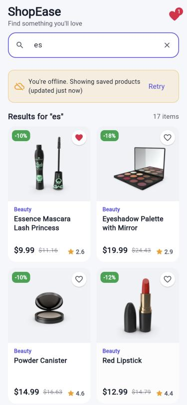
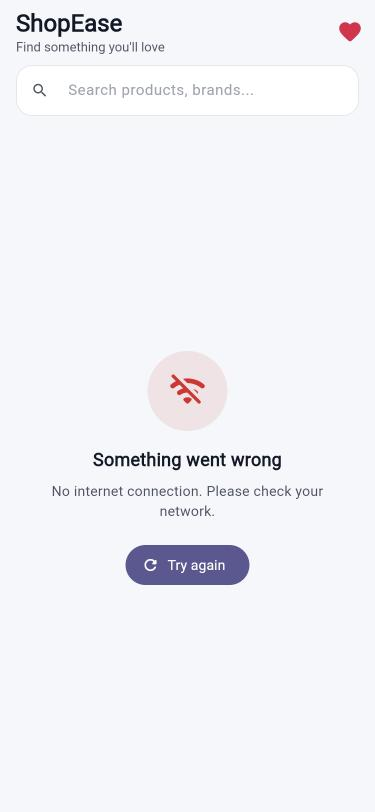
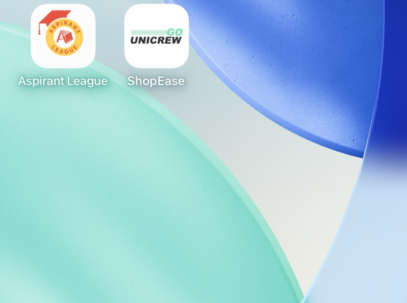
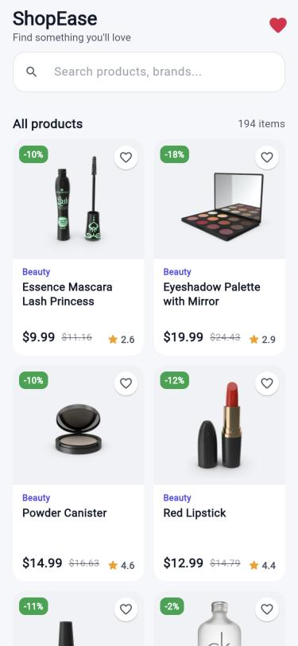

<p align="center">
  
</p>

<h1 align="center">ShopEase – Product Listing App</h1>

<p align="center">
  Flutter assignment for <b>GO UNICREW PVT. LTD.</b><br/>
  A product listing app built on the DummyJSON Products API, with search, pull-to-refresh,
  infinite scroll, a product detail screen and offline support using local storage.
</p>

<p align="center">
  
  
  
  
  
</p>

---

## Contents
1. [Task requirements](#1-task-requirements)
2. [Features](#2-features)
3. [Screenshots](#3-screenshots)
4. [Tech stack & packages](#4-tech-stack--packages)
5. [State management – why Bloc](#5-state-management--why-bloc)
6. [Architecture & data flow](#6-architecture--data-flow)
7. [Folder structure](#7-folder-structure)
8. [API details](#8-api-details)
9. [Local storage](#9-local-storage)
10. [Error handling](#10-error-handling)
11. [Setup & run](#11-setup--run)
12. [Testing](#12-testing)
13. [App icon](#13-app-icon)
14. [Troubleshooting](#14-troubleshooting)
15. [Assumptions & notes](#15-assumptions--notes)

---

## 1. Task requirements

| # | Requirement | Status | Where |
|---|---|---|---|
| 1 | Fetch products from the API | ✅ | `ProductRepository.getProducts()` |
| 2 | Show image, title and price | ✅ | `ProductCard`, `PriceWidget` |
| 3 | Handle loading indicator and error state | ✅ | `ProductGridSkeleton`, `AppMessageView`, `ProductListFooter` |
| 4 | Working search | ✅ | `AppSearchField` + `Debouncer` + `SearchProductsEvent` |
| 5 | Product detail screen | ✅ | `ProductDetailScreen` |
| 6 | Pull-to-refresh | ✅ | `RefreshIndicator` + `FetchProductsEvent(completer)` |
| 7 | Reusable widgets & proper folder structure | ✅ | `global_widgets/`, feature-wise `presentation/` |
| 8 | State management with a reason for the choice | ✅ | Bloc (see [section 5](#5-state-management--why-bloc)) |
| ➕ | Local storage | ✅ | Offline cache, recent searches, favourites |
| ➕ | Pagination | ✅ | Infinite scroll, 20 items per page |
| ➕ | Unit tests | ✅ | 15 tests (models, storage, bloc) |

## 2. Features

### Product list
- 2-column grid that adds columns on wider screens (`SliverGridDelegateWithMaxCrossAxisExtent`).
- Each card shows the image, category, title, price, struck-out original price, discount badge, rating and a favourite heart.
- **Infinite scroll:** the next 20 products load before you reach the bottom.
- **Pull-to-refresh:** the current list stays visible while refreshing. If the refresh fails, the old data stays and a toast explains why.
- The app bar badge shows the number of favourites.

### Loading states
- **First load:** a pulsing skeleton grid the same size as the real cards.
- **Next page:** a small spinner at the bottom of the grid.
- **Images:** a placeholder while loading and a fallback icon if the image fails.

### Error & empty states
- **Full-screen error:** an icon, a readable message (no internet, timeout, server error…) and a **Try again** button.
- **Next page fails:** a "Couldn't load more. Tap to retry" footer. The grid isn't replaced.
- **No search results:** an empty state that shows the keyword.

### Search
- **Debounced:** waits 500 ms after the last keystroke before calling the API.
- Uses the DummyJSON `/products/search` endpoint, and results are paginated too.
- **Old responses are ignored:** if you type "pho" and then "phone", a late response for "pho" never replaces the "phone" results.
- **Recent searches:** the last 6 keywords show as chips when the search box is focused. You can tap one to search again, remove one, or clear them all.
- **Offline search:** the saved product list is filtered locally by title, brand, category and description.

### Product detail
- Swipeable image gallery with page dots and a **Hero** animation from the list.
- Category chip, rating, number of reviews, brand.
- Price, original price and "% OFF" badge.
- Stock status: green when in stock, orange below 10 left, red when out of stock.
- Description, shipping, warranty and return policy.
- Customer reviews with star ratings.
- Bottom bar with the price and an **Add to wishlist** button.

### Offline support
- After every successful load, the first page is saved to local storage.
- If the API fails, the saved products are shown with an **"You're offline. Showing saved products (updated X min ago)"** banner and a Retry button.
- Images are cached on disk by `cached_network_image`.

## 3. Screenshots

| Product list | Loading (skeleton) | Search | Recent searches |
|---|---|---|---|
|  |  |  |  |

| Product detail | Detail – reviews | Offline (cached data) | Error state |
|---|---|---|---|
|  |  |  |  |

| App icon (iOS home screen) | Web build |
|---|---|
|  |  |

## 4. Tech stack & packages

| Package | Version | Why |
|---|---|---|
| `flutter_bloc` | ^9.1.1 | State management (Bloc pattern) |
| `equatable` | ^3.0.0 | Value equality for states and models, so the UI only rebuilds when something changed |
| `dio` | ^5.11.1 | HTTP client with interceptors, timeouts and typed errors |
| `shared_preferences` | ^2.5.6 | Local storage for the offline cache, recent searches and favourites |
| `cached_network_image` | ^4.0.3 | Image caching with placeholder and error widgets |
| `flutter_launcher_icons` (dev) | ^0.14 | Generates the Android, iOS and web app icons |

## 5. State management – why Bloc

I chose **flutter_bloc** because:

1. **Clear separation.** Screens only send events and draw state. All logic (paging, search, caching, offline fallback) lives in `ProductBloc`, so it can be tested without any widgets.
2. **Predictable state.** One `PageStatus` enum (`initial → loading → success / failure`) drives the screen, so the UI can never show a loader and an error at the same time.
3. **Independent flags.** Paging has its own `isLoadingMore` / `loadMoreFailed` flags, so loading page 2 never replaces the grid with a full-screen loader.
4. **Testable.** Repositories are provided once with `MultiRepositoryProvider` and passed into the bloc through its constructor, so tests can use a `FakeProductRepository` without any mocking library.
5. **Scales well.** The same pattern is used in larger production apps, and adding a feature means adding a new event and handler.

**Events**

| Event | Purpose |
|---|---|
| `FetchProductsEvent({completer})` | First load, retry, or pull-to-refresh (a refresh when a completer is passed) |
| `LoadMoreProductsEvent` | Next page |
| `SearchProductsEvent(query)` | Debounced search (an empty query shows the full list again) |
| `SaveRecentSearchEvent` / `RemoveRecentSearchEvent` / `ClearRecentSearchesEvent` | Recent search chips |
| `ToggleFavouriteEvent(id)` | Wishlist heart |

**State:** `ProductState` holds `pageStatus, products, total, searchQuery, isLoadingMore, loadMoreFailed, isOfflineData, lastSyncedAt, errorMessage, recentSearches, favouriteIds`.

## 6. Architecture & data flow

```
 UI (presentation/)                 ProductBloc (data/view_models/)          Data sources
 ───────────────────                ───────────────────────────────          ────────────
 ProductListPage  ── event ──▶  FetchProducts / Search / LoadMore  ──▶  ProductRepository ──▶ Dio ──▶ DummyJSON
       ▲                               │                                     (BaseRepository +
       │                               │ success: cache page 1                 ApiClientService +
       └──────── new state ◀───────────┤                                       AppInterceptor)
                                       │ failure: read cache  ──────────▶  ProductLocalStorage ──▶ SharedPreferences
                                       ▼
                                   ProductState (Equatable)
```

1. The screen sends an event, for example `SearchProductsEvent("phone")`.
2. The bloc sets `loading` and calls `ProductRepository`.
3. The repository uses the shared `ApiClientService` (a single Dio instance). `AppInterceptor` logs requests in debug mode and turns Dio errors into readable exceptions.
4. **On success:** the bloc saves page 1 through `ProductLocalStorage` and emits `success`.
5. **On failure:** the bloc tries the cache. If saved products exist, it emits `success` with `isOfflineData = true`. If not, it emits `failure` with the message.

## 7. Folder structure

```
lib/
├── main.dart                         # init Prefs + Dio, MultiRepositoryProvider, MaterialApp
├── common_libraries.dart             # one barrel import used by every file
│
├── constants/
│   ├── color.dart                    # AppColor
│   ├── dimens.dart                   # AppDimens (spacing, radius)
│   └── app_strings.dart              # AppStrings (all UI text)
│
├── core/
│   ├── api_urls/base_urls.dart       # base url + endpoints
│   ├── base/base_repository.dart     # shared get/post for all repositories
│   ├── exception/app_exceptions.dart # NoInternet, Timeout, NotFound, ServerError…
│   ├── services/
│   │   ├── api_client_services.dart  # Dio singleton (timeouts, interceptors)
│   │   └── app_interceptor.dart      # logging + error mapping
│   └── utils/
│       ├── page_status.dart          # initial / loading / success / failure
│       ├── app_toaster.dart          # snackbar helper
│       ├── app_utils.dart            # price format, original price, timeAgo, errorMessage
│       └── debouncer.dart            # search debounce
│
├── data/
│   ├── models/                       # ProductModel, ReviewModel, ProductResponseModel
│   ├── repositories/                 # ProductRepository
│   ├── storage/                      # Prefs, PrefKeys, ProductLocalStorage
│   └── view_models/product/          # product_bloc.dart, product_event.dart, product_state.dart
│
├── global_widgets/widgets/           # reusable across features
│   ├── custom_loader_widget.dart
│   ├── app_network_image.dart
│   ├── app_message_view.dart         # error + empty states
│   ├── app_search_field.dart
│   ├── price_widget.dart
│   ├── rating_badge.dart
│   └── favourite_button.dart
│
└── presentation/features/
    ├── product_list/
    │   ├── product_list.dart         # screen
    │   └── widgets/                  # product_card, product_grid_skeleton, product_list_footer,
    │                                 # recent_search_section, offline_banner
    └── product_detail/
        ├── product_detail.dart       # screen
        └── widgets/                  # product_image_gallery, stock_status_chip,
                                      # product_highlight_tile, review_card

test/
├── test_helpers.dart                 # FakeProductRepository + fake data
├── models/product_model_test.dart
├── storage/product_local_storage_test.dart
└── view_models/product_bloc_test.dart

assets/app/                           # app logo used for launcher icons
screenshots/                          # screenshots used in this README
```

## 8. API details

Base URL: `https://dummyjson.com` (no API key needed)

| Purpose | Endpoint | Params |
|---|---|---|
| Product list | `GET /products` | `limit=20`, `skip`, `select` |
| Search | `GET /products/search` | `q`, `limit=20`, `skip`, `select` |

`select` limits the response to the fields the UI uses (title, price, images, reviews, …), which keeps the payload small.

Sample response:
```json
{
  "products": [{ "id": 1, "title": "Essence Mascara Lash Princess", "price": 9.99, "discountPercentage": 10.48, "rating": 2.56, "thumbnail": "https://cdn.dummyjson.com/…", "...": "..." }],
  "total": 194, "skip": 0, "limit": 20
}
```

## 9. Local storage

`shared_preferences` is accessed through the typed `Prefs` / `SharedPrefValue<T>` wrapper, and all product-related storage is in `ProductLocalStorage`.

| Key | Type | What's stored |
|---|---|---|
| `cached_products` | `String` (JSON) | First page of products, used offline |
| `last_synced_at` | `String` (ISO date) | Time of the last successful load, shown in the offline banner |
| `recent_searches` | `List<String>` | Last 6 keywords, newest first, no duplicates |
| `favourite_ids` | `List<String>` | IDs of wishlisted products |

## 10. Error handling

`AppInterceptor` maps every Dio error to a custom exception whose `toString()` is a message you can show to users:

| Case | Exception | Message shown |
|---|---|---|
| No network / DNS failure | `NoInternetConnectionException` | No internet connection. Please check your network. |
| Connect / send / receive timeout (20 s) | `DeadLineExceededException` | The request timed out. Please try again. |
| 400 | `BadRequestException` | API `message`, or "Invalid request" |
| 404 | `NotFoundException` | The requested item was not found. |
| 500 | `InternalServerErrorException` | Something went wrong on the server… |
| Other status codes | `ServerErrorException` | Server is currently unavailable… |
| Invalid JSON | `FormatException` | Received invalid data from server. |

How each failure is handled in the UI:

| Situation | Result |
|---|---|
| First load fails, saved data exists | Saved products with the offline banner |
| First load fails, nothing saved | Full-screen error with **Try again** |
| Refresh fails | Old list stays, plus an error toast |
| Next page fails | Retry footer, grid unchanged |
| Search fails | Saved products filtered locally |

## 11. Setup & run

### Requirements
- Flutter **3.32+** (Dart 3.8+). Tested on **Flutter 3.44.0 / Dart 3.12.0**.
- **Android:** Android Studio with an SDK and an emulator or device.
- **iOS:** macOS with Xcode and a simulator or device.
- An internet connection for the first launch.

### Steps

Clone the repository:
```bash
git clone https://github.com/rupeshrajak0285/GOUNICREW-PVT.-LTD..git
```

Go into the project folder:
```bash
cd GOUNICREW-PVT.-LTD.
```

Install packages:
```bash
flutter pub get
```

Run on a connected device, emulator or simulator:
```bash
flutter run
```

### Build

Android APK:
```bash
flutter build apk --release
```

iOS (simulator):
```bash
flutter build ios --simulator
```

Web:
```bash
flutter build web --release
```

## 12. Testing

```bash
flutter test
```

15 unit tests, all passing:

| File | What it covers |
|---|---|
| `models/product_model_test.dart` | JSON parsing (int/double prices, missing fields), original-price calculation, `toJson → fromJson` round trip, gallery fallback, category formatting |
| `storage/product_local_storage_test.dart` | Product cache + timestamp, recent-search order/dedupe/limit, favourites |
| `view_models/product_bloc_test.dart` | First load + cache, pagination to the end, error without cache, offline fallback, search, refresh failure keeps the data, favourite saved |

`flutter analyze` reports no issues.

## 13. App icon

The launcher icon is the GO UNICREW logo, generated with `flutter_launcher_icons`:
- `assets/app/app_logo.png`: 1024×1024 logo on white, used for iOS, web and older Android versions.
- `assets/app/app_logo_foreground.png`: transparent foreground for the **Android adaptive icon**, kept inside the safe zone so it isn't cropped.

To regenerate the icons after changing the logo:
```bash
dart run flutter_launcher_icons
```

## 14. Troubleshooting

**iOS: `Uncategorized (Xcode): Exited with status code 255`**
Codesign fails with *"resource fork, Finder information, or similar detritus not allowed"*. This happens when the project is inside an iCloud-synced folder such as `~/Documents` or `~/Desktop` with "Desktop & Documents" sync on. iCloud adds extended attributes to `Flutter.framework`, and Xcode refuses to sign it. Move the project to a folder that isn't synced (for example `~/StudioProjects`), then run:
```bash
flutter clean && flutter pub get && flutter run
```

**Android release build can't reach the API**
`android.permission.INTERNET` is already declared in `android/app/src/main/AndroidManifest.xml`. Debug builds add it automatically, but release builds need it in the main manifest.

## 15. Assumptions & notes
- DummyJSON only returns the discounted price, so the struck-out original price is calculated as `price / (1 - discount/100)`.
- The detail screen uses the product object passed from the list, so it opens instantly with no extra API call.
- Only the main list's first page is cached. Search results are not cached, because they depend on the keyword.
- Favourites are stored only on the device. There's no login or backend for this assignment.

---

**Author:** Rupesh Rajak – Senior Flutter Developer
GitHub: [@rupeshrajak0285](https://github.com/rupeshrajak0285)
